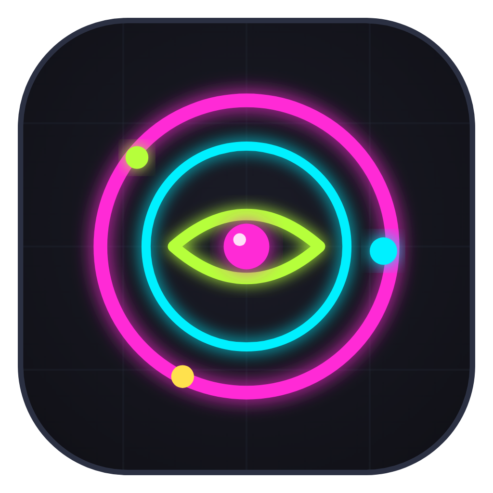
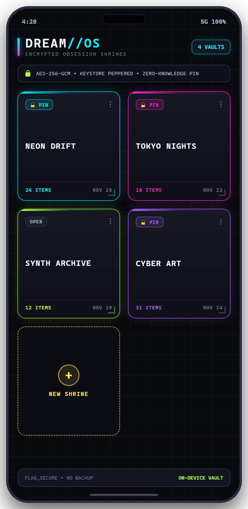
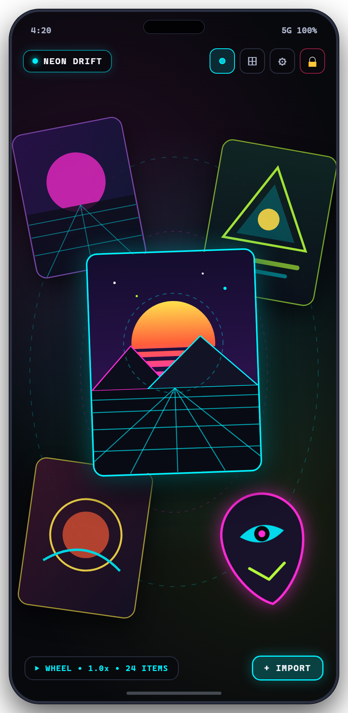
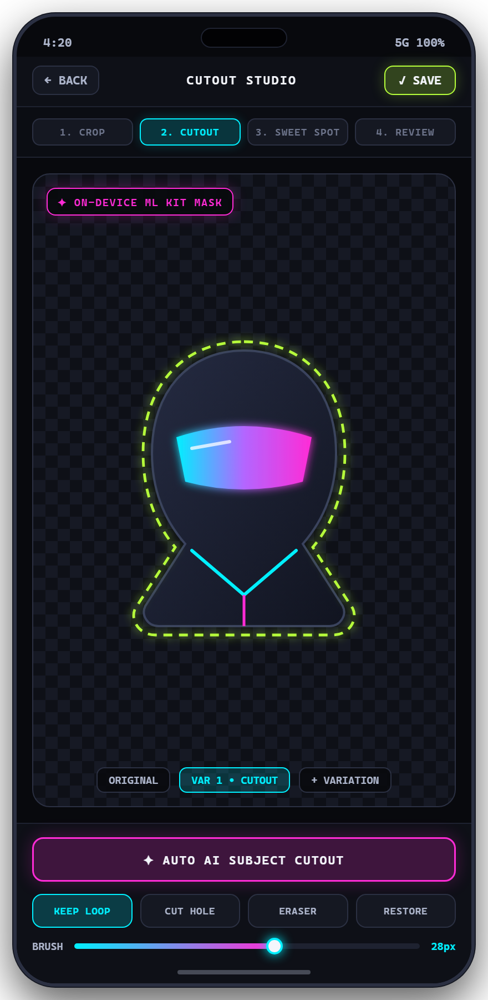

<p align="center">
  
</p>

# DreamOS

PIN-encrypted revolving poster board, collage waterfall, and on-device cutout studio for Android.

Built with **Kotlin** and **Jetpack Compose (Material 3)**, DreamOS lets you organize private visual boards ("shrines") protected by per-board zero-knowledge encryption, hardware-backed Android Keystore wrapping, and on-device AI subject segmentation.

<p align="center">
  
  &nbsp;
  
  &nbsp;
  
</p>

> *UI mockups — in-app screenshots are blocked at the OS level via `FLAG_SECURE` to prevent decrypted frames from leaking to disk.*

## Features

- **Encrypted Visual Boards**: Create multiple independent boards with custom neon color themes and optional per-board PIN locks with brute-force lockout protection.
- **Revolving Poster Board & Fullscreen Viewer**: Smooth animated revolving board view with fullscreen inspection, keep-screen-on while unlocked, and configurable idle session timeouts.
- **On-Device Cutout Editor & Variations**: Non-destructive editing with on-device **ML Kit Subject Segmentation** (images never leave your device) and support for creating multiple encrypted variations from a single source image.
- **Full System Document Picker**: Imports directly from system storage, Downloads, and galleries via `ACTION_OPEN_DOCUMENT` with multi-select support.

## Security & Encryption Architecture

- **Zero-Knowledge Per-Board PIN + Hardware Pepper**: Each board generates a random 256-bit AES Data Encryption Key (`DEK`). That `DEK` is wrapped by `PBKDF2-SHA256(HMAC_KeystorePepper(salt || PIN), salt, 250k)` and wrapped a second time by a non-exportable Android Keystore `AES-256-GCM` key.
- **Forensic Hardening**:
  - Original EXIF metadata (GPS coordinates, camera serials, timestamps) is stripped in memory before encryption.
  - Every blob (`.o` untouched original, `.r` rendered display, `.t` thumbnail, `.m` AI alpha mask, and `meta.bin`) is encrypted with `AES-256-GCM` using filename-bound AAD.
  - Cloud backup and device-to-device transfer are completely disabled (`allowBackup="false"`, `fullBackupContent="false"`, and `data_extraction_rules.xml`).
  - `FLAG_SECURE` prevents Android's Recents switcher and screenshots from caching decrypted frames to disk.
  - Backgrounding the app or hitting the idle timeout automatically locks the active board and evicts decrypted bitmaps from memory.
  - Deleting a board performs **crypto-shredding** (destroys the wrapped `DEK` first, then overwrites and deletes ciphertext blobs).

## Requirements

- **Android 8.0+ (API 26+)** (`targetSdk 36`, `compileSdk 36`)
- **Android Studio** (or JDK 17+ with Android SDK configured)

## Building & Installing

### Option A — Android Studio
1. Clone this repository and open the project folder in **Android Studio**.
2. Connect an Android device (USB or Wireless Debugging) and click **Run ▶**.

### Option B — Command Line (`gradlew` + `adb`)

**Windows (PowerShell):**
```powershell
git clone https://github.com/tailgunnerx/DreamOS.git
cd DreamOS
.\gradlew.bat assembleDebug
adb install -r app\build\outputs\apk\debug\app-debug.apk
```

**macOS / Linux:**
```bash
git clone https://github.com/tailgunnerx/DreamOS.git
cd DreamOS
./gradlew assembleDebug
adb install -r app/build/outputs/apk/debug/app-debug.apk
```

> **Note:** On side-loaded builds, the on-device ML Kit Subject Segmentation model is downloaded on first use. Images are processed locally and never leave the device.

## Tech Stack

- **Kotlin** `2.2.10` & **Jetpack Compose** (Material 3)
- **Android Gradle Plugin** `9.2.0`
- **AndroidX Lifecycle & ViewModel**, **ExifInterface**, **Kotlin Coroutines**
- **Google ML Kit Subject Segmentation** (on-device)

## License

This project is licensed under the **GNU General Public License v3.0** — see [LICENSE](LICENSE) for details.
